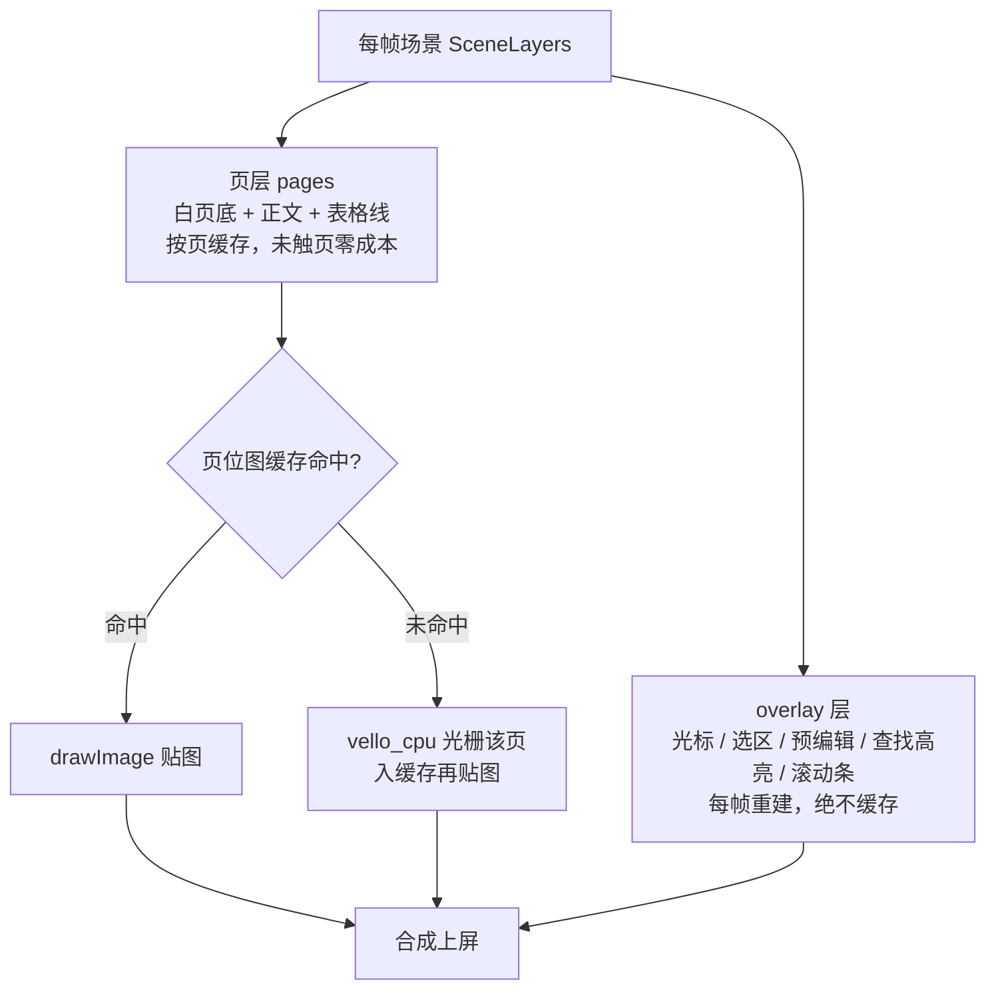

# GPU 优先，CPU 兜底：Word 编辑器的渲染路径选型

> 摘要：[office-rs/rword](https://github.com/office-rs) 的渲染层做了一次看似"奢侈"的投入：为 Web 端写了一个完整的 CPU 软渲染器，专门服务那些"没有 GPU"的机器。这篇文章讲清楚我们为什么把 GPU 渲染作为第一选择（以及为此从 Canvas2D 迁移到 WebGPU 的原因），为什么又必须为无 GPU 环境兜底，以及让 CPU 路径跑出 60fps 的整套工程设计。上一篇文章[《打一个字等 5.3 秒》](./rword-layout-performance)讲了排版引擎的优化，这一篇讲它的下游——像素怎么画到屏幕上。

---

## 01 先说结论

一句话版本的决策：

- **有 GPU，用 GPU**——Vello + WebGPU，原生与 Web 跑同一条渲染管线；
- **Web 端没 GPU，自动降级 CPU 软渲染**——完整编辑能力，不是只读查看器；
- **原生端没 GPU，启动预检直接报错退出**——不崩溃、不给黑屏。

看起来是三条废话，但每一条背后都有一段实测数据和一次踩坑。展开讲。

## 02 为什么 GPU 是第一选择

### 编辑器的帧本质：全视口重绘

先看工作负载。rword 采用"纸在桌上"（paper-on-desk）的呈现模型：视口是灰色的桌面，白色的纸居中摆放，滚动、缩放、光标闪烁、选区拖拽都是连续动画。这意味着每一帧都要把可见区域完整地呈现一遍——矢量场景重放、字形上屏、合成，一帧都不能少。

这种"每帧全量、内容复杂"的负载正是 GPU 的主场。GPU 路径的一帧成本实测 **2.15~3.06 毫秒**，余量大到我们可以在每一帧都做全量呈现而不管优化——三层脏缓存（布局脏 → 场景脏 → 呈现）保证重计算只发生在内容真正变化时，而最后的"画"这个动作对 GPU 来说近乎免费。

### 一致性：一套内核，两个平台像素一致

rword 的核心承诺是"同一份排版结果，原生与 Web 输出一致"。渲染层如果不统一，这个承诺就断了。

我们的第一版 Web 渲染用的是 Canvas2D，它有两个先天缺陷：

1. **跨边界逐字调用**：每个字形都要从 WASM 调一次浏览器的 `fillText`，JavaScript↔WASM 边界开销随文字数量线性增长，一页中文就是几千次跨界；
2. **度量不一致**：字形最终由浏览器文本引擎绘制，它的度量与我们的排版引擎（Parley）存在亚像素级差异——同一个文档，网页上和原生应用里长得不完全一样。

迁移到 Vello + WebGPU 后，字形不再经过浏览器：**skrifa 直接从字体二进制里取字形轮廓，在 GPU 上光栅化**。原生长什么样，网页就长什么样，一个像素都不差。这条管线与原生端完全同构——其实不存在"Web 渲染器"和"原生渲染器"两个东西，只有一套渲染器编译到了两个目标。

### 选 WebGPU 而不是 WebGL2 / Canvas2D 的原因

WebGPU 是目前 Web 平台唯一的现代 GPU 标准 API（Chrome/Edge 113+），提供 compute shader——而 Vello 的核心思路恰恰是把路径光栅化搬到计算着色器上做大规模并行。WebGL2 没有 compute，Canvas2D 更是连批渲染都做不到。所以这条路在我们选型时没有第二选项。

当然 GPU 不是免费的：首次渲染要触发着色器编译（实测 1~3 秒），我们在启动时主动调用 `warmup()` 把这个成本前置到加载页；这些代价换来的帧预算余量，后面 CPU 路径的对比会让它更直观。

## 03 现实检查：GPU 不是总在那

"检测到 WebGPU 就用，检测不到就提示用户升级浏览器"——我们最初也是这么想的，直到把用户环境列了一遍：

- **企业/机构的办公电脑**：域策略统一禁用浏览器硬件加速（这是 IT 部门最喜欢的安全基线之一）；
- **虚拟机 / 远程桌面**：没有 GPU 直通，或者适配器对 WebGPU 不可见；
- **老旧机器**：驱动太旧，WebGPU 适配器申请失败。

这些不是边缘案例——文档编辑器的真实付费场景（病历系统、政务、企业 OA）恰恰大量部署在这类环境里。用户不能选，我们只能兜。

### 实测：降级没有捷径

我们做了四组对照探针，结论让人死心：

| 实验 | 结果 |
| --- | --- |
| Chrome 146 禁用硬件加速，`requestAdapter()` | 返回 **null** |
| 同环境加 `forceFallbackAdapter: true` | **依然 null** |
| 原生端在 WARP（Windows 软件适配器）上跑 Vello | 进程崩溃，exit code **0xc0000005**（访问违例） |

两个要点：

**第一，Web 端的"软件回退适配器"救不了场**。Chromium 已经移除了 SwiftShader 自动回退（issue 40277080），禁了硬件加速就是真的没有 GPU 可用——浏览器不会给你一个 CPU 模拟的 WebGPU。想要 CPU 渲染，只能自己写。

**第二，原生端的 Vello 不能跑在软件适配器上**——不是慢，是崩溃。所以原生端必须在启动时做 GPU 预检：拿不到硬件适配器就弹出清晰的错误框退出，绝不进入渲染循环。

这里有一个不对称的设计逻辑值得点出：**Web 必须兜底，原生可以硬性要求**。因为 Web 的运行环境由用户的机器和策略决定，开发者控制不了；而原生应用的部署环境是可控的，装不上 GPU 的环境直接明确报错反而是最诚实的做法。

## 04 兜底的产品原则：降级不降功能

决定了要做 CPU 回退，第一条原则就不是技术而是产品：

> **CPU 回退是完整的编辑器，不是只读查看器。**

这是我们写进设计文档的反目标（anti-goal）："CPU 回退退化成只读查看器——做得再对也算失败"。打字、选区、中文输入法、查找替换、内容控件、表格、页眉页脚，GPU 路径有什么，CPU 路径就有什么。用户在虚拟机里打开文档，不应该发现自己进了一个阉割版。

SDK 侧的暴露也极简：默认 `cpuFallback: true`，WebGPU 不可用时自动落入 CPU 路径并在控制台输出回退标记，宿主可以通过 `onWarning` 感知。用户什么都不用做。

但"能用"和"可用"之间隔着一个性能问题，这才是工程的硬骨头。

## 05 让 CPU 跑出 60fps：三层设计

裸的 CPU 软渲染是什么水平？实测（1600×900 文字密集页，全视口光栅）：

| 环境 | 每帧光栅成本 | 无缓存滚动帧率 |
| --- | --- | --- |
| 原生（台式机 CPU） | 9.67 ms | ~100 fps |
| WebAssembly（同机） | ×1.2~2 | 50~80 fps |
| 弱机（真正的无 GPU 目标机） | ×2~3 | **15~30 fps** |

结论写在设计文档里就一句话：**页位图缓存是入场券，不是可选优化**。围绕它有三层设计：

### 第一层：页面位图缓存——滚动只画一次

每一页排版完成后光栅成位图，按六元组键缓存：`(page_id, page_gen, zoom_key, font_gen, render_gen, dpr)`——页身份、布局世代（上篇文章的增量布局产出）、缩放手势停稳值、字体世代、像素配置世代、设备像素比。任何一项没变，滚动时直接 `drawImage` 贴图。

缓存有界：LRU 默认 5 页 + 单页 8M 像素上限。效果：**滚动帧从 15~30fps 回到 1~3 毫秒/帧，稳稳 60fps**。

一个容易被忽略的边角：A4 满档缩放加高分屏就触达像素上限，此时不能静默跳过那一页——那会留下一个"灰洞"。修法是等比降采样光栅、贴图时放大回整页（略糊而非消失），外加一次性控制台告警。

### 第二层：分层——什么该缓存，什么绝不该缓存

页面位图解决"不变的纸"，但光标在闪、选区在变、输入法预编辑在下划线里抖动。所以场景被拆成两层：

页层缓存的失效键就是上面那套世代号体系——它直接消费增量布局给出的 `page_gen`，所以**打一个字只有当前页的位图失效重画，其余页纹丝不动**。这与上篇文章的四层缓存模型（段落 → 页布局 → 页场景 → 页位图）是同一套设计在渲染端的延伸。

### 第三层：与增量布局的化学反应

单靠位图缓存，滚动是流畅了，打字还差一口气：每次编辑都触发重排，如果重排是 O(全文档) 的（300 页打一个字 5.3 秒），CPU 路径光栅再快也救不回来。**增量布局是 CPU 回退"接近 GPU 手感"的前提**——这也是我们把它作为前置工作流先行的原因。两件事拼起来，CPU 路径的打字、滚动、缩放才全部达标。

### 缩放手势：一个容易投毒的状态机

缩放是缓存体系最阴险的场景：手势进行中每一帧缩放系数都不同，若按最终缩放键把中间帧写入缓存，手势结束后缓存里全是尺寸错误的"投毒"条目。我们的规则：

- 手势中：缓存命中就拉伸旧位图（模糊但流畅），miss 只走一次性光栅（**不入缓存**）；
- 手势停稳 200 毫秒后：整体换代，按新缩放键重新光栅，恢复锐利。

体验上就是"捏合时略糊、松手变清晰"——所有地图应用的同款策略，但背后是"策略函数纯逻辑化、原生单测覆盖"的工程保障。

### 按需渲染的兼容

rword 的渲染循环是按需的：内核返回下一帧需求（立刻重画 / N 毫秒后 / 挂起），挂起时零定时器零 CPU。CPU 路径完全兼容这套契约——补排、光栅预算都通过"下一帧再排"表达，标签页隐藏时整个循环静止，后台零功耗。

## 06 那些只有真浏览器才能抓到的坑

CPU 路径的实现借用了兄弟项目 rofd 的成熟方案（18 个 commit + 两轮线上修复的教训），这里挑三个最经典的，给要做同类事情的人避雷：

**坑一：静默失败是最贵的失败。** 有一类 bug 能隐形一整天：像素数据上传到 canvas 时类型不匹配（`js-sys` 的 `Uint8ClampedArray::view()` 在新版本里返回的其实是普通 `Uint8Array`，静态类型在撒谎），`new ImageData()` 抛 TypeError——如果错误被 `?` 静默吞掉，现象只有"画布只剩灰底"，零报错、零日志。修法除了显式构造 clamped 数组，更是一条铁律：**所有像素上传/绘制失败路径必须 `console.error`，点名尺寸与原因**。

**坑二：冒烟测试必须断言像素。** 上面那个 bug 之所以能上线，是因为冒烟测试只断言了"回退标记已输出"——在静默失败的场景下它是绿灯。修法：CDP 采样画布像素，断言 distinct colors ≥ 3（灰底 / 白页 / 正文黑字），并且这个冒烟进了 CI。**console 断言测的是"代码跑了"，像素断言测的才是"用户看见了"**。

**坑三：canvas 上下文绑定顺序。** 先给 canvas 绑了 WebGPU context，adapter 申请失败后再想拿 2d context——永远拿不到了，CPU 回退必挂。这个顺序错误 mock 测不出来，只有真浏览器端到端能抓。修法是 adapter 探测永远先行，成功之后才创建 surface。

还有画灰底的画家算法顺序、dpr 单位全局唯一（双乘导致位图放大两倍）等等，都属于"单测全绿、上线必挂"系列。它们的共同教训：**渲染管线的正确性只能靠真环境像素级验证**。

## 07 两条路径的成本对照

把所有数字放在一张表里（同机实测）：

| 指标 | GPU 路径 | CPU 路径（无缓存） | CPU 路径（位图缓存后） |
| --- | --- | --- | --- |
| 每帧呈现成本 | 2.15~3.06 ms | 9.67 ms（原生）/ ×1.2~3（wasm/弱机） | **1~3 ms（滚动/阅读态）** |
| 打字手感 | 流畅 | 依赖全量重排，不可用 | 增量布局加持，接近 GPU |
| 首帧成本 | 着色器编译 1~3 s（可 warmup 前置） | 无编译，直接可画 | 同左 |
| 环境要求 | Chrome/Edge 113+ 且硬件加速开启 | 同为现代 Chrome/Edge 系 | 同左 |
| 功能完整性 | 完整 | **完整（反目标兜底）** | 完整 |

注意 CPU 路径的适用边界我们也想清楚了：它依然要求现代 Chromium 内核（Safari 至今不在支持范围），兜的是"GPU 不在"，不是"浏览器太老"。

## 08 这套设计的优势在哪

**1. 环境无关的可用性。** 医院、政务、企业 OA 的真实机器环境千奇百怪；rword 是同一套 SDK，GPU 机器跑出 120fps 的丝滑，无 GPU 机器自动落 CPU 路径且功能一项不少。宿主一行配置都不用加。

**2. GPU 路径零妥协。** CPU 回退通过渲染目标的分层协议默认合流实现——GPU 目标不覆写新接口，走的还是原路径，行为与渲染结果零变化，另有结构对拍测试保证合流等价。为兜底付出的复杂度全部隔离在 CPU 目标内部，没有向主路径泄漏一分。

**3. 双路径同源，正确性可验证。** 两条路径消费同一个 `imaging::Scene` 场景中间表示——排版引擎产出一份场景，GPU 重放它，CPU 也重放它。一致性不是"应该差不多"，而是有对拍测试背书的结构等价。

**4. 把教训固化成门禁。** 像素断言冒烟进 CI、失败路径必须输出日志、缓存投毒策略纯函数化单测——rofd 踩过的每个坑都变成了可执行的检查项，而不是"下次注意"。

## 09 写在最后

渲染路径选型这件事，本质上是在回答一个问题：**你的用户在什么机器上，以及你愿意为最差的那台机器付多少工程成本**。我们的答案是：为最好的机器给足性能上限（GPU + 全量帧预算），为最差的机器守住功能底线（CPU + 完整编辑 + 60fps 滚动），并且让两条路共享同一个排版与场景内核——降级的是像素的生产方式，不是产品。

排版侧的故事（5.3 秒到 6 毫秒、千页文档渐进打开）见上一篇[《打一个字等 5.3 秒：Rust 版 Word 排版引擎的优化之路》](./rword-layout-performance)。欢迎关注 [office-rs](https://github.com/office-rs)。
