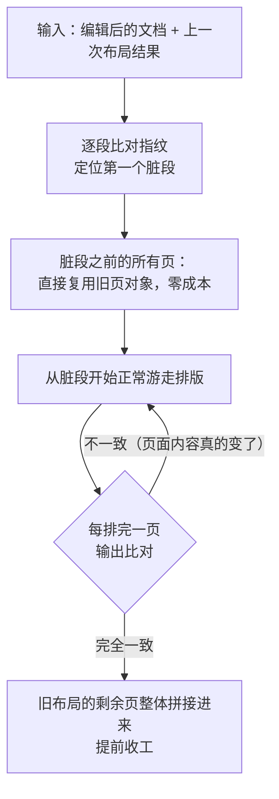
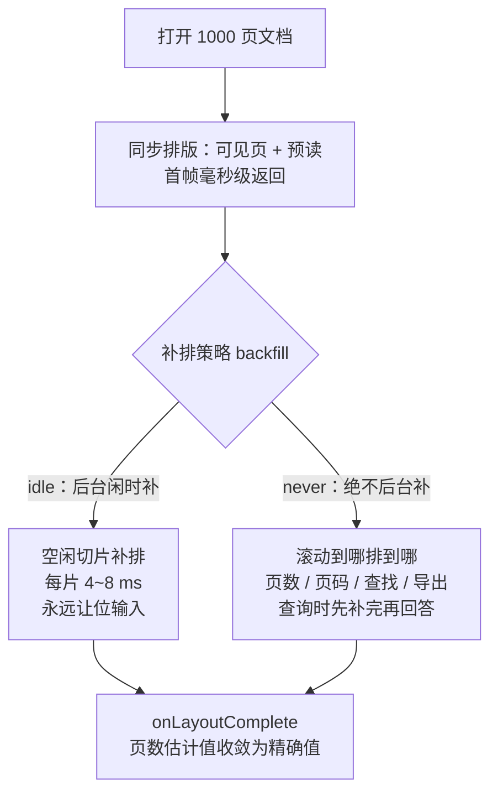

# 打一个字等 5.3 秒：Rust 版 Word 排版引擎的优化之路

> 摘要：[office-rs/rword](https://github.com/office-rs) 是一个用 Rust 编写的 Word 文档编辑器组件库——读写 .docx（ISO/IEC 29500），原生（Vello + Parley）与 Web（WebAssembly + WebGPU）双端同构，同一份排版内核保证两个平台输出一致。这篇博客记录我们最近对排版引擎的两轮大改造：**增量布局**把 300 页文档的打字延迟从 5.3 秒压到 6 毫秒，**渐进排版**让千页大文档"先看见、再补完"。文章不讲结论先行，而是从 Word 排版本身难在哪讲起，把每个设计的动机、机制和踩过的坑摊开来讲，力求你读完能看懂我们为什么这么设计。

---

## 01 300 页的文档，打一个字等 5 秒

先看一份实测文档。在我们自己的性能探针下（300 页中文文档，release 构建），编辑体验是这样的：

| 探针项（300 页文档） | p50 耗时 | 说明 |
| --- | --- | --- |
| 打一个字（含重新排版 + 重建渲染场景） | **5339 ms** | 用户视角：按下一个键，卡 5 秒 |
| 输入法预编辑（每敲一个拼音） | 5158 ms | 中文输入下，每个音节都卡 |
| 打开文档到首帧（300 页 / 1000 页） | 5.06 s / 17.2 s | 约 17 ms/页，完全线性 |
| 滚动 | 0.19 ms | 流畅，无问题 |

最有意思的是最后两行的反差：**滚动很流畅，打字却卡死**。原因我们后文会讲，这也是整个优化的线索来源。

还有一个更隐蔽的问题：这个 bug 在小文档上**永远不会暴露**。1~3 页的文档打一个字只要 17~50 毫秒，用户完全无感；GPU 渲染路径上，那 5 秒的排版成本还只被 2~3 毫秒的 GPU 光栅时间"盖"住了一部分感知。等到 300 页的病床记录式长文档打开，一切原形毕露。

## 02 Word 排版到底难在哪

在讲怎么优化之前，先回答一个更根本的问题：为什么 Word 这类程序的排版引擎值得单独写一篇博客？把文本摆到屏幕上，浏览器、VS Code 都做得很好，Word 难在哪？

### 分页，是 Word 排版和网页排版的分水岭

浏览器排版是**流式**的：内容从上往下流，视口就是世界，滚多远内容就有多远。VS Code、网页编辑器都是这个模型。

Word 是**分页排版**：内容要流进一张张固定尺寸的"纸"里。A4 纸的宽高、页边距是死的，内容跨页流动；页眉页脚每页重复；页码从 1 开始编号。这意味着排版引擎的输出不是"一长条内容"，而是"一堆页面，每页有精确的边界"。

```
流式排版（浏览器）          分页排版（Word）
┌──────────┐              ┌────────┐ ┌────────┐
│ 段落 1    │              │ 页眉    │ │ 页眉    │
│ 段落 2    │              │ 正文... │ │ 正文... │ ← 第 2 页
│ 段落 3    │   向下流动    │─────────│ │────────│
│ ...      │  ────────→   │ 页脚 1  │ │ 页脚 2  │
│ (没有页)  │              └────────┘ └────────┘
└──────────┘                内容要"流"进固定的纸
```

### 改一处，动全身

分页带来一个根本性的耦合：**内容是连续的，纸是离散的**。你在第 3 页中间删掉一行，后面的内容整体上移——第 3 页剩余部分要重排，第 4 页、第 5 页……直到文档末尾，每一页的"哪些内容落在这一页"都可能变化。

更麻烦的是几个循环依赖：

- **页码域（PAGE）**要按"这段文字显示在第几页"求值——排完才知道；
- **总页数域（NUMPAGES）**出现在页脚里，而总页数要**整篇排完**才知道——排版结果依赖自己；
- 页眉页脚有继承链（"同前节"），一节的高度变化会影响分页，分页又影响哪些页显示哪一节。

### 看不见的输入：排版结果不只取决于"这段文字"

这是后续增量化最大的坑，值得单独强调。直觉上，一个段落怎么排只取决于它的内容和格式。但实际上，大量"排版输入"不在段落里：

| 隐形输入 | 例子 |
| --- | --- |
| 编号列表的计数器 | 在第 10 段前面插入一段，第 10 段之后所有列表项的编号都变了——但那些段落的**内容一个字节都没变** |
| 域的求值上下文 | 同一个 PAGE 域，在第 3 页显示"3"，在第 4 页显示"4" |
| SDT（内容控件）属性 | 属性挂在段落外层的包装节点上，改属性不改变段落本身 |
| 浮动对象的锚点 | 锚点段没变，但图片"落"到了哪一页可能变 |
| 跨页表格 | 同一张表在页界处被切成上下两半，行怎么分片属于"页的身份" |

我们给这类问题起了个名字：**"指纹不变而像素变"**——段落的指纹（内容+属性）没变，但它渲染出来的像素变了。任何缓存方案如果不把这些隐形输入算进指纹，就会留下一条无声的错误通道：缓存命中，渲染错误，而且没有报错。

### 中文排版与兼容性硬约束

CJK 文档还有额外一层：一段中文字符可能命中多个字体（宋体、雅黑、以及 fallback 链上的任意一个），字体又可能以"切片"形式逐片到达 Web 端（我们此前专门为 Web 设计了[字体切片方案](https://github.com/office-rs)），每次新切片到达都可能改变字符的形状度量。

最后是无法回避的兼容性约束：用户拿 Word/WPS 打开同一个 .docx，分页结果应该基本一致。这意味着排版模型**不能偷工减料**——分页、页眉页脚、编号、域、表格、浮动对象，一个都不能少。

## 03 病因解剖：时间到底花在哪

回到 5.3 秒。原因一句话就能说完：**每按一个键，整篇文档从头重排一遍**。布局引擎没有任何段落级记忆——`layout()` 每次全量遍历所有段落，重新 shape、重新分页；编辑器组件在每次编辑后全量重排 + 全场景重建。输入法预编辑更惨：每次还要克隆整份文档、插入"幽灵文本"再全排一遍。

但"加缓存"之前，我们先做了一件更重要的事：**测量**。我们拿同一份 300 页文档在 wordcraft（另一个 Rust 排版引擎）上对拍：它冷排 1.08 秒，我们 2.9 秒——差距是 2.7 倍，而不是坊间传闻的 30~80 倍。这说明我们的问题不是"架构性落后"，而是某些具体开销。

对每段 244µs 的排版时间做逐层拆解，结果出乎意料：

- 逐字成本只有 0.65µs/字符——真正"干活"的部分非常快；
- **84% 的时间（约 200µs/段）是与内容完全无关的每段固定开销**——一个 1 字符的段和一个 200 字符的段，成本几乎一样；
- 样式级联 1.7µs、缓存键哈希 1.3µs、缓存写入 3.7µs——全都不是嫌疑人；
- 最终把固定开销钉死在 Parley（我们用的文本排版库）内部：**shaper 的内部缓存挂在一个"每段落都被重建"的上下文对象上，缓存永远冰冷**，每段都要重建 shaper 数据。

修复小得出奇：让引擎持有**一个** shaper 贯穿所有段落，而不是每段新建。效果：

| 冷排（300 页文档） | 修复前 | 修复后 | 降幅 |
| --- | --- | --- | --- |
| 拉丁文段落 | 97.1 µs/段 | 50.5 µs/段 | -48% |
| 中文段落 | 125.4 µs/段 | 44.5 µs/段 | **-64%** |
| 1 字符段落（纯固定开销） | 49.5 µs | 8.9 µs | -82% |
| 整档冷排（中文） | 1505 ms | **534 ms** | -64% |

这一轮的教训值得记住：**优化之前先测量，先找到"与工作无关的固定开销"**。它比任何精巧的缓存都便宜。

但修复之后，冷排依然是 O(文档) 的线性成本，打字依然全量重排。下面进入正题：三剂药方。

## 04 药方一：段落记忆化——没变的段落别再排

第一剂药是所有缓存方案的原点：给每个段落的排版结果做记忆化。


机制本身朴素，难点全在**指纹怎么算**：

- **槽位**：按（story，段落下标）组织，槽里存（内容指纹，排版结果）。
- **指纹字段集**：段落文本 + 段落/字符属性 + 有效宽度（栏/节上下文）+ 表格上下文 + 浮动排除区 + **已计算的列表标签** + 编号计数器状态。后两项正是 02 节说的"隐形输入"——上游插入会改变后续段的编号，段落指纹却不变，所以编号必须进键。
- **全局环境哈希（env_hash）**：样式表、编号定义、页面几何、字体集合、栏配置。任何一项变化（比如 Web 端又一片字体到达了），整个缓存清空重来——因为全局变化可能影响任何段落。
- **页眉页脚段落单独一套槽位**，且键里要带"显示页号"——同一个页码域，第 3 页和第 4 页的求值结果不同，只按段落键会把第 3 页的"3"串到第 4 页去。

一个重要的设计取向：**缓存 miss 是"正确但慢"的路径，绝不会是"错误"的路径**。结构编辑（拆段/并段/删除）会让段落下标错位，指纹对不上就老老实实重排——慢，但对。宁可退化，不可排错。

## 05 药方二：脏段起排 + 尾部拼接——向 LibreOffice 借三十年的经验

记忆化只解决了"没变的段落不要重排"，但没回答另一个问题：**排在脏段后面的内容怎么办？** 一个文档 300 页，改了第 10 段，第 11 段之后的 290 页依然要全部重排——因为分页可能变了。

这正是 LibreOffice 用三十年打磨出来的问题，它有一条结构性原则：

> **两端变更检测：修复后的矩形没变，就不向下游传播——级联"死"在第一个未变的 frame 上。**

翻译到我们的纯函数式布局，整套机制分三步：



**第一步，头部复用。** 脏段之前的页与旧布局必然完全一致（纯函数 + 输入未变），直接复用旧页对象，一个字节都不重算。

**第二步，脏段起排。** 从第一个脏段开始正常游走排版。

**第三步，页身份比对 + 尾部拼接。** 每排完一页，与旧布局同一位置的页做比对，全部一致就把旧布局的剩余页整体"拼接"过来，立刻停止。

这里的点睛之笔是**比对什么**。我们比对的不是 04 节的段落指纹，而是**物化后的页内容输出**：列表标签文本、域求值结果、SDT 属性、浮动锚点落点、表格行分片、页眉页脚高度、栏几何、内容序列。这是对"指纹不变而像素变"的釜底抽薪——就算缓存因为某条隐形输入漏判而喂出一个**过期**的标签或域值，输出一比（和旧页的**真实**输出）就对不上，拼接被拒绝，排版继续走到正确的结果。**过期数据在结构上不可能被拼进最终布局**，而不是"我们小心一点所以不会"。

典型打字的成本由此变成：**重排 1 个段落 + 比对 1 个页面**——这正是 LibreOffice 的 TurboAction 在做的同款事情。

### 渲染层跟着一起受益

布局产出每页会带一个**世代号（page_gen）**：这次重建的页世代 +1，拼接复用的页保持旧世代。渲染层的页场景缓存、CPU 路径的页位图缓存都以它为失效键——于是"打一个字"在渲染端也只重建**被触到的那一页**，其余页面在四层缓存（段落 → 页布局 → 页场景 → 页位图）里全部保持身份，零成本。

### 正确性怎么保证：差分测试

增量化最怕的就是"大部分时候对，偶尔错一位"。我们的防线是一套差分测试：随机生成编辑序列，**增量排版的结果必须与全量排版深度相等**，并且断言"未变的页必须复用旧对象"。测试用例必须覆盖 02 节点名的每一个静默错排面——编号列表、浮动锚点、页码域、SDT 属性、跨页表格——缺一个，就等于留下一条无声的错误通道。

## 06 药方三：渐进排版——千页文档先看见，再补完

两剂药下完，打字已经流畅。但还有最后一块硬骨头：**冷启动**。1000 页文档打开，哪怕每页 25 毫秒，全量排完也要 25 秒——用户盯着白屏等（L0 修复把这个数字压掉了一个数量级，但第 08 节真实文档复测会看到：千页中文全量冷排仍有 2.6 秒，白屏只是短了，没有消失）。

我们的第一反应是行业默认方案："常驻轻"——只保留可见页的排版结果，滚出去就丢。但调研了三个成熟引擎后，我们发现**没有一家这么做**：

| 引擎 | 冷启动策略 |
| --- | --- |
| LibreOffice | 可见页同步排 + 后台闲时补排，页对象惰性创建但常驻 |
| wordcraft | 全量每排，但足够便宜 |
| OnlyOffice | 渐进分页，页数在后台增长 |

结论：**所有引擎都选择"最终全量物化"，只把"付费时机"挪到打开之后**。道理很朴素——页数、页码、查找、导出，这些正确性关键的信息都必须建立在完整布局上；常驻轻会把正确性问题撒到每一个消费点。所以我们同样只改"付费时机"，这就是**渐进排版**：



两种策略对应两类应用的诉求：

- **idle 模式**：打开后后台闲时补排。渲染循环每帧只花 4~8 毫秒在补排上，有输入立刻让位（LibreOffice 的同款纪律）；标签页隐藏时自动暂停——我们的按需渲染循环本来就支持隐藏时零定时器，补排只是挂了一个新的唤醒源。过渡期页数是估计值（按已排内容的密度外推），补完时回调校正。
- **never 模式**：绝不后台排版（适合对功耗敏感的场景）。代价是正确性关键查询改为**查询时同步补完**：应用取页数、全文查找、导出打印——先补排到尾，再回答。宁可慢一次，不可给错值。

这个设计是我们的业务约束直接塑造的：电子病历场景里，打开文档后应用立刻读页数/页码，**拿到过错值是不可接受的**；但病历常态文档又不大，所以渐进排版必须是**显式开启（opt-in）**，默认关闭时行为与现状逐字节相同。

当然没有免费的午餐：拖动滚动条跳到未排区域，需要同步排到目标位置（有界停顿，秒级冻结帧，界面给进度提示）；这是 v1 明确接受并文档化的取舍，分块异步着陆留作后续。

## 07 补一块拼图：无 GPU 环境的完整编辑

上面所有优化与渲染路径无关，但它们还有一位服务对象：**CPU 软渲染回退**。虚拟机、禁用硬件加速的老办公机上 WebGPU 不可用，Web SDK 自动落入 CPU 光栅。CPU 光栅比 GPU 慢，如果排版还是全量重排，就彻底不可用——增量布局正是"CPU 回退接近 GPU 手感"的前提。

架构上渲染端做了**页面级分层缓存**：光栅按页缓存为位图（LRU + 像素总量上限），滚动时未触页直接 blit，实测滚动帧 1~3 ms；输入法预编辑、光标、选区、查找高亮这类每帧都变的元素拆到独立 overlay 层轻量重绘。注意我们坚持的原则：CPU 回退是**完整的编辑器**，打字、选区、中文输入法、查找替换全部可用，绝不退化成只读查看器。

## 08 端到端：现在打一个字花多久

把三剂药组装起来，"打一个字"的完整链路变成：

> 编辑器命令 O(1) → 重排 1 个段落 → 比对 1 个页面 → 重建该页的渲染场景 →（CPU 路径）光栅该页 → 其余所有页在四层缓存中保持身份，零成本。

| 场景（本机 release 实测） | 优化前 | 优化后 |
| --- | --- | --- |
| 300 页文档打一个字（端到端） | 5339 ms | **6.07 ms（约 880 倍）** |
| 输入法预编辑刷新（同文档） | 5158 ms | 25.8 ms（场景缓存落地后目标 ≤8 ms） |
| 300 页中文文档冷排（布局层） | 1505 ms | **534 ms** |
| 300 页文档滚动 | 0.19 ms/帧 | 0.28 ms/帧（本就流畅） |
| 1000 页文档冷启动 | 25.2 s 全量排完 | 渐进排版：首帧毫秒级（落地中，门禁 ≤1.5 s） |

需要说明的是测量语境：这些数字来自同一台机器、同一套探针的合成文档，不同文档形态（带页脚和总页数域的变体）会有两位数毫秒的浮动；优化前后的对比是同一探针的端到端口径，不是挑好看的数。

### 换成真实 docx 文件再测一遍

合成探针证明机制有效，但文档编辑器的用户打开的是 .docx 文件——数据要经过完整的 OOXML 解码，段落形态也与合成文档不同（真实文档段落少而长，合成探针是每页 40 个短段）。我们用一组固定测试文档（100 / 300 / 500 / 1000 页 × 中 / 英，共 8 份）把同一条管线完整复测了一遍：

| 文档 | 段落数 | 实排页数 | 解码 | 冷排（全量） | 二次排版 | 打一个字（布局层） | 输入法预编辑 |
| --- | --- | --- | --- | --- | --- | --- | --- |
| 100 页 中文 | 243 | 126 | 60 ms | 214 ms | 4.0 ms | 4.9 ms | 6.1 ms |
| 100 页 英文 | 221 | 133 | 58 ms | 207 ms | 3.8 ms | 4.3 ms | 4.5 ms |
| 300 页 中文 | 708 | 355 | 166 ms | 658 ms | 13.8 ms | 15.8 ms | 17.2 ms |
| 300 页 英文 | 601 | 333 | 141 ms | 579 ms | 12.3 ms | 16.3 ms | 16.7 ms |
| 500 页 中文 | 1102 | 511 | 304 ms | 1115 ms | 23.4 ms | 28.0 ms | 28.8 ms |
| 500 页 英文 | 1012 | 565 | 220 ms | 1012 ms | 20.8 ms | 24.8 ms | 27.8 ms |
| 1000 页 中文 | 2133 | 949 | 517 ms | **2575 ms** | 45.4 ms | 56.1 ms | 62.6 ms |
| 1000 页 英文 | 1831 | 933 | 489 ms | 2092 ms | 39.6 ms | 48.2 ms | 52.5 ms |

（本机 release 实测，`cargo run -p rword-export --release --example docx_bench`，p50 口径；"打一个字"= 改写文档中段一个段落后的增量重排，"输入法预编辑" = 克隆整档插入组合文本的 ghost 排版，两者均为布局层成本，不含场景构建——组件级端到端口径见上表。）

三件事在这张表里看得更清楚：

- **渐进排版（药方三）的立项依据在真实文档上依然成立**：千页中文文档全量打开 = 解码 517 ms + 冷排 2575 ms ≈ 3.1 秒。L0 修复已经把冷排从每页 25 ms 压到约 2.6 ms/页，但 1000 页乘出来仍然是用户盯着白屏的三秒——这就是为什么"先看见、再补完"不可省。
- **段落记忆化的命中率经得起真实文档检验**：同一引擎上不改动再排一遍（二次排版），千页文档 45 ms，只有冷排的 **1/57**——除了被打字触到的那一小块，其余全部从缓存复用。
- **打字延迟随文档规模只有亚线性增长**：百页 5 ms → 千页 56 ms，增长远慢于文档规模本身（增量机制的直接体现），且"打一个字"与"输入法预编辑"几乎重合——ghost 排版的整档克隆在千页文档上只占约 6 ms，不是瓶颈。

### 打开到首页可见：渐进排版的实测答卷

上表是布局层成本。"打开文档"的用户体验还要加上解码与场景构建，然后由渲染管线画出来——这才是用户感知的"首页渲染时间"。在组件级端到端口径（解码 → 加载 → 首帧 `update_scene`，含场景构建）下对同一份千页中文文档各测 5 次（p50）：

| 打开 test_1000p_cn.docx（949 页） | 首帧耗时 | 加上解码的合计 |
| --- | --- | --- |
| 渐进排版关闭（全量排版完才出首帧） | 2232 ms | ≈ 2.8 s |
| **渐进排版 idle（只排可见页 + 预读）** | **21.7 ms** | ≈ 0.6 s，其余页面由后台闲时补排 |

布局 + 场景部分从 2.23 秒压到 21.7 毫秒，**约 100 倍**——"先看见、再补完"从设计目标变成了可录屏的事实。下面是真实 Web 应用的录屏（拖入同一份文档，渐进排版开启）：


录屏里可以看到三件事：拖入文件后首页在一帧内呈现（没有白屏等待）；点击定位时光标与格式工具栏立即就绪；快速滚动浏览开头数页，内容已排版完毕、滚动全程没有"排到这里才现画"的停顿——首屏之外的页面由预读与按需排版接力保障。

## 09 我们的优势在哪里

复盘这一路，rword 相对同类方案的优势可以归纳为四条：

**1. 真正的分页排版内核，而不是"网页编辑器 + 分页皮肤"。** 很多 Web 文档产品在 contenteditable / 流式布局上模拟分页，页眉页脚、跨页表格、页码域这类能力先天残缺。rword 的排版引擎从第一性原理实现分页模型，.docx 原生读写，和 Word/WPS 打开同一份文件分页一致。

**2. 双端同构，一套内核跑两个平台。** 同一个 Rust 排版内核，原生编译（Vello GPU 渲染）和 Web 编译（WebAssembly + WebGPU，无 GPU 时 CPU 回退）输出一致。Web 端以 npm 包 `@office-rs/rword` 一行接入，也提供原生组件；还有无头导出管线（docx→PDF）复用同一条排版路径，保证"编辑所见 = 导出所得"。

**3. 性能与正确性被工程化地绑在一起。** 增量排版配上差分测试（增量 ≡ 全量，逐位断言）；页面拼接配上输出比对（过期数据结构上无法混入）；渐进排版配上部分性契约清单（每个消费点逐一扫除）；每个优化都有性能门禁和探针，退化即失败。快，且可证明地对。

**4. 站在巨人的肩膀上，但不抄作业。** 我们大量研读了 LibreOffice（级联止损、TurboAction、闲时补排）和现代 Rust 排版引擎的源码，移植的是**原则**（级联死在第一个未变的 frame、输入让位补排），而不是机制——机制的形态由我们纯函数式布局的架构决定。

## 10 写在最后

这篇博客覆盖的是排版引擎主干的两个战役：增量布局（已落地，打字手感达标）和渐进排版（设计中，千页大文档最后一战）。后面还在排队的事情：编辑器向布局推送脏区提示（把每趟全文档校验的固定成本也省掉）、DOM 节点 Arc 化（消掉输入法预编辑的整档克隆）。

如果你在做文档类产品——在线 Office、病历系统、合同平台——欢迎关注 [office-rs](https://github.com/office-rs)，也欢迎交流排版引擎的各种爱恨情仇。
